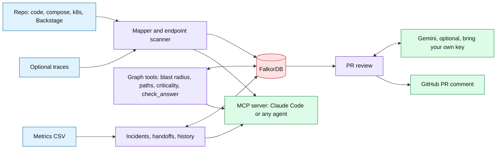
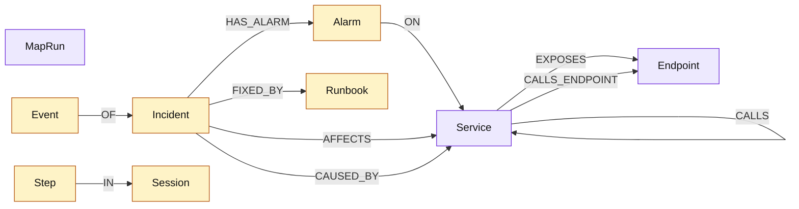

# NextTrace

**A shared, verified map of your services that AI agents and code reviewers can trust: who calls whom, what breaks if something fails, and what fixed it last time. Stored in FalkorDB.**


[![FalkorDB](https://img.shields.io/badge/FalkorDB-graph%20database-0B0B12?style=for-the-badge&logo=data%3Aimage%2Fsvg%2Bxml%3Bbase64%2CPHN2ZyB4bWxucz0iaHR0cDovL3d3dy53My5vcmcvMjAwMC9zdmciIHdpZHRoPSI1MDgiIGhlaWdodD0iNTA4IiB2aWV3Qm94PSIwIDAgNTA4IDUwOCIgZmlsbD0ibm9uZSI%2BPGcgY2xpcC1wYXRoPSJ1cmwoI2NsaXAwXzE0NjJfMjA0KSI%2BPHJlY3QgeT0iLTEiIHdpZHRoPSI1MDgiIGhlaWdodD0iNTA4IiByeD0iNjMuNSIgZmlsbD0idXJsKCNwYWludDBfbGluZWFyXzE0NjJfMjA0KSI%2BPC9yZWN0PjxyZWN0IHk9Ii0xIiB3aWR0aD0iNTA4IiBoZWlnaHQ9IjUwOCIgcng9IjYzLjUiIGZpbGw9InVybCgjcGFpbnQxX2xpbmVhcl8xNDYyXzIwNCkiPjwvcmVjdD48cGF0aCBkPSJNNDU5LjQ0OCAyNDcuMjYzQzQ1OS4wNiAyNDkuMjczIDQ1OC4yOTUgMjUxLjI2NSA0NTcuNDY1IDI1My4wMzZDNDU2LjE3NCAyNTUuNzc1IDQ1NC40NzcgMjU4LjM1NyA0NTIuNDM5IDI2MC41OThDNDQ3LjgwOSAyNjUuNjcxIDQ0MS4yNzEgMjY4LjI1MyA0MzQuNTc2IDI2OS42MDhDNDI3Ljg4IDI3MC45NjQgNDA3LjU3MyAyNzAuMDg4IDM5OS4wODkgMjY4LjA0MUMzNzcuNDgxIDI2Mi44MjEgMzU1LjE4MiAyNjIuOTQxIDM0MS45NjYgMjY4LjA1QzMzMy41ODMgMjcxLjI5NiAzMzAuNjUxIDI3My4xNSAzMjYuMjI0IDI3Ni45NjhDMzA4LjcxMSAyOTIuMDI3IDMwMC44NzIgMzI4LjQ1NSAyOTMuOTE5IDM0OS44OTdDMjg5LjE4OCAzNjQuNTYgMjg0LjU0OSAzNzkuODIzIDI3My45MjUgMzkxLjM3OEMyNTcuNTY1IDQwOS4xNDkgMjMwLjMzMiA0MTQgMjA1LjYzNSA0MTRIOTcuMTU0NkM5NS43OTg5IDQxNCA5NC43NzUyIDQxMi43NzMgOTUuMDQyNyA0MTEuNDM2TDk3LjU4OCAzOTguMzVDOTkuNjUzOCAzODcuNjg5IDEwOS4wMDUgMzc5Ljk5OCAxMTkuODY5IDM3OS45OThIMTkyLjcwNkMyMTMuNzMyIDM3OS45OTggMjM2LjIzNCAzNzcuMDU2IDI0Ny44OTEgMzYwLjk2M0MyNTQuNDMgMzUxLjkxNiAyNTYuMzExIDM0MC43MTEgMjU4Ljk4NSAzMzAuMDUxQzI2OC4zNDYgMjkyLjcyOCAyNzEuNDU0IDI1OC4yMTkgMzA4LjgyMiAyNDMuNUMyOTcuODExIDIzNi42MjEgMjg5LjgwNiAyMjUuNDk5IDI4Ny4wMjEgMjEzLjI3QzI4MS45MDIgMTkwLjY5NCAyOTQuMDExIDE2Ny45NjIgMjk1LjEzNiAxNDQuODk3QzI5NS42MzQgMTM1LjA3NSAyOTMuMzE5IDEyMy45OTkgMjg0LjY5NyAxMTguNTQ5QzI3OC42NTYgMTE0LjcyMiAyNzAuOTEgMTE0LjYxMSAyNjMuNjUyIDExNC42MTFDMjM2LjQwOSAxMTQuNjM5IDIxOS4xODIgMTE0LjY1NyAxODcuNTA0IDExNC42NzZIMTgwLjE0NUMxNjUuODk3IDExNC42ODUgMTU1LjE5OSAxMDEuNjkxIDE1Ny45MTkgODcuNzEwMUwxNTguNjg1IDgzLjc0NDZDMTU4Ljg3OSA4Mi43MjA5IDE1OS43NDUgODIuMDAxNiAxNjAuNzc4IDgyLjAwMTZDMTc3LjYzNyA4Mi4wMDE2IDI0MS42MDIgODIuMTAzIDI3My42OTUgODIuMDAxNkMyOTIuMjIyIDgxLjk1NTUgMzEzLjAzNiA4Mi44MjI0IDMyNS41NzkgOTUuNzI0MkMzMjkuNzM4IDEwMC4wMTMgMzMyLjM5NCAxMDQuOTkyIDMzMy45NjIgMTEwLjM4N0MzMzQuMDM1IDExMC42IDMzNC4wOTEgMTEwLjgzIDMzNC4xNTUgMTExLjA1MUMzMzcuNzUyIDEyNC4yNjcgMzM0LjkyMSAxMzkuODUyIDMzMS4yOTYgMTUzLjYyMUMzMjYuNjMgMTcxLjUzMSAzMjEuNjMyIDE5Mi4zNDUgMzMxLjYyOCAyMDkuNDYxQzMzNS42MDMgMjE2LjI1OCAzNDEuODI4IDIyMS4yOTMgMzQ5LjIyNCAyMjMuOTU5QzM1My4zNTYgMjI1LjQ1MyAzNTUuMTI2IDIyNi4yIDM1OS41MTYgMjI2LjE2M0MzNjEuNzExIDIyNi4xNDQgMzYzLjg5NyAyMjUuOTIzIDM2Ni4wNjQgMjI1LjUzNkMzNzAuMzggMjI0Ljc3OSAzNzUuMDc0IDIyMy43MjggMzc4Ljk2NiAyMjIuOTYzQzM4MC44MjkgMjIyLjU5NCAzODIuNzAxIDIyMi4yNjIgMzg0LjU5MSAyMjEuOTk0QzM4OS43MTkgMjIxLjI3NSAzOTUuMjA2IDIyMS4xMzcgNDAwLjQyNiAyMjIuMTc5QzQwNC4yNTMgMjIyLjk0NCA0MDcuOTg4IDIyNC4zNTUgNDExLjE4OCAyMjYuNjA1QzQxNC41OTEgMjI5LjAwMyA0MTYuNjAyIDIzMS45ODIgNDE4LjM5MSAyMzUuNjcxQzQxOS4zOTYgMjM3LjczNyA0MjAuNjQxIDIzOS44MyA0MjIuNjcgMjQwLjkwOUM0MjYuMzAzIDI0Mi44NDYgNDMxLjkzOCAyNDEuNTQ1IDQzNS44NDggMjQxLjIzMkM0MzkuOTE1IDI0MC45MDkgNDQzLjk1NSAyNDAuMjczIDQ0OC4wMTIgMjM5LjgwMkM0NDkuOTg2IDIzOS41NzIgNDUxLjk1OSAyMzkuMzY5IDQ1My45NDIgMjM5LjI3N0M0NTUuNTAxIDIzOS4yMDMgNDU3LjE5OCAyMzkuNDA2IDQ1OC4zNjkgMjQwLjU1OUM0NTkuMjA4IDI0MS4zODggNDU5LjYwNSAyNDIuNTg3IDQ1OS42OTcgMjQzLjc2OEM0NTkuNzggMjQ0LjkxMSA0NTkuNjc4IDI0Ni4wODMgNDU5LjQ1NyAyNDcuMjU0TDQ1OS40NDggMjQ3LjI2M1oiIGZpbGw9IiNGN0YzRUYiPjwvcGF0aD48cGF0aCBkPSJNMTgyLjc2MiAxODMuMjc5TDE3Mi42MjYgMjM1LjE2M0MxNzIuMzU5IDIzNi41NTYgMTczLjQyIDIzNy44NDcgMTc0Ljg0IDIzNy44NDdIMjI5LjE1OEMyMzAuNTc5IDIzNy44NDcgMjMxLjYzOSAyMzkuMTM4IDIzMS4zNzIgMjQwLjUzMUwyMjguOTU1IDI1My4wNTRDMjI2LjkwOCAyNjMuNjYgMjE3LjYyMSAyNzEuMzMzIDIwNi44MjIgMjcxLjMzM0gxNjcuNTA4QzE2Ni40MjkgMjcxLjMzMyAxNjUuNDk4IDI3Mi4wOTggMTY1LjI5NSAyNzMuMTU5TDE1NC42NjIgMzI3Ljg0NkMxNTIuNjA1IDMzOC40NDMgMTQzLjMxOCAzNDYuMDg4IDEzMi41MjggMzQ2LjA4OEgxMTAuNTI0QzEwOS4xMDQgMzQ2LjA4OCAxMDguMDQ0IDM0NC43OTcgMTA4LjMxMSAzNDMuNDA0TDE0NS45MDEgMTQ5Ljc5NEMxNDYuMTAzIDE0OC43MzMgMTQ3LjAzNSAxNDcuOTY4IDE0OC4xMTQgMTQ3Ljk2OEgyNTQuMDk1QzI1NS41MTUgMTQ3Ljk2OCAyNTYuNTc2IDE0OS4yNTkgMjU2LjMwOCAxNTAuNjUxTDI1My44OTIgMTYzLjE3NUMyNTEuODQ1IDE3My43ODEgMjQyLjU1OCAxODEuNDUzIDIzMS43NTkgMTgxLjQ1M0gxODQuOTg0QzE4My45MDUgMTgxLjQ1MyAxODIuOTc0IDE4Mi4yMTkgMTgyLjc3MSAxODMuMjc5SDE4Mi43NjJaIiBmaWxsPSIjRjdGM0VGIj48L3BhdGg%2BPC9nPjxkZWZzPjxsaW5lYXJHcmFkaWVudCBpZD0icGFpbnQwX2xpbmVhcl8xNDYyXzIwNCIgeDE9IjUwOCIgeTE9Ii0wLjk5OTk3NCIgeDI9Ii03MS4wMjIzIiB5Mj0iMTAwLjA1NCIgZ3JhZGllbnRVbml0cz0idXNlclNwYWNlT25Vc2UiPjxzdG9wIHN0b3AtY29sb3I9IiNGRjY2QjMiPjwvc3RvcD48c3RvcCBvZmZzZXQ9IjEiIHN0b3AtY29sb3I9IiNGRjgwNEQiPjwvc3RvcD48L2xpbmVhckdyYWRpZW50PjxsaW5lYXJHcmFkaWVudCBpZD0icGFpbnQxX2xpbmVhcl8xNDYyXzIwNCIgeDE9IjI1NCIgeTE9IjUwNyIgeDI9IjI1NCIgeTI9Ii0wLjk5OTk4OSIgZ3JhZGllbnRVbml0cz0idXNlclNwYWNlT25Vc2UiPjxzdG9wIHN0b3AtY29sb3I9IiM3NDY2RkYiPjwvc3RvcD48c3RvcCBvZmZzZXQ9IjAuOTk1NjM2IiBzdG9wLWNvbG9yPSIjNzQ2NkZGIiBzdG9wLW9wYWNpdHk9IjAiPjwvc3RvcD48L2xpbmVhckdyYWRpZW50PjxjbGlwUGF0aCBpZD0iY2xpcDBfMTQ2Ml8yMDQiPjxyZWN0IHdpZHRoPSI1MDgiIGhlaWdodD0iNTA4IiBmaWxsPSJ3aGl0ZSI%2BPC9yZWN0PjwvY2xpcFBhdGg%2BPC9kZWZzPjwvc3ZnPg%3D%3D)](https://www.falkordb.com/)
[](https://www.python.org/)
[](https://py.sdk.modelcontextprotocol.io/)
[](https://hub.docker.com/r/falkordb/falkordb)
[](integrations/github/nexttrace-pr-review.yml)
[](https://ai.google.dev/)
[](https://www.anthropic.com/claude-code)
[](https://docs.astral.sh/uv/)
[](tests/)


> **Live deployment and video**

- **Live:** the PR bot runs on every pull request in [AmanTechWiz/train-ticket](https://github.com/AmanTechWiz/train-ticket/pulls). There is no hosted web app; the rules allow local setup instead, and the steps above take about five minutes.
- **Demo video:** TODO (author): add the link.


---

## The problem

Modern products are split into many small services that call each other over the network. When one of them changes or fails, the damage shows up somewhere else, often two or three services away. The knowledge of "who depends on this" lives in people's heads, stale wiki pages, or nowhere at all.

So an engineer renames an endpoint and a booking flow in another team's service starts failing. An on-call engineer at 3am sees forty alarms and has to guess which one is the cause. And AI coding agents make it worse in one specific way: asked "who calls this?", they answer confidently and cite code that does not exist (we measured this, see [Results](#results)).

## What it does

**Point NextTrace at a repo and it builds a graph of your services in FalkorDB, with the exact code line behind every connection. Agents and the PR bot then answer from that graph instead of guessing.**

- **Maps services from real code and config.** Kubernetes, docker-compose, Backstage, .NET Aspire and Dockerfiles for services; config, code (Java, Python, Node, Go, C#, gRPC) and recorded traces for calls, down to the exact route. Every connection keeps its evidence (`file:line` or traffic count). Several repos can share one graph.
- **Answers impact questions over many hops.** What breaks if a service fails, how requests reach it, which services matter most (FalkorDB PageRank and betweenness). Every answer cites the connections it used.
- **Reviews pull requests.** A GitHub Action maps the repo, finds the services and routes a PR touches, and posts one plain-language comment: what changed, who will break, and the exact lines, with an optional Gemini review that may only cite graph facts.
- **Lets AI agents extend the map, but only with proof.** An agent can add a connection or service only if the quoted code really exists at that line. The server checks it, and checks agents' answers too.
- **Remembers incidents across agents and sessions.** Alarms become incidents, agents hand them off through version-checked claims, the cause must cite live map connections, and fixes are recalled the next time.

## Why a graph (the removal test)

If FalkorDB were removed, the product would stop working. These are not lookups that a table or a vector index would do just as well:

| Capability | What it needs from the graph | Where |
|---|---|---|
| Blast radius: "if `payments` fails, what breaks?" | Variable-length traversal `(:Service)-[:CALLS*1..6]->(:Service)`, shortest chain per affected service, stale edges filtered per hop | [`nexttrace/failure.py`](nexttrace/failure.py) |
| Criticality ranking | `algo.pageRank` and `algo.betweenness` run inside FalkorDB over every call | [`nexttrace/failure.py`](nexttrace/failure.py) |
| PR review: "this renamed route still has 3 callers" | Joins changed files to `Service`, its `Endpoint` routes, and the `CALLS_ENDPOINT` edges into them, plus the full blast radius | [`nexttrace/pr_review.py`](nexttrace/pr_review.py) |
| Incident triage | Groups alarms by how their services are linked on the map (a path between services within N hops) | [`nexttrace/memory.py`](nexttrace/memory.py) |
| Answer checking | Every call an agent cites is looked up as a stored edge; claimed chains must hold hop by hop | [`nexttrace/failure.py`](nexttrace/failure.py) |
| Memory | Incidents, fixes and agent steps are nodes linked to the real `Service` nodes, so "similar past incident" is a graph overlap | [`nexttrace/memory.py`](nexttrace/memory.py) |

We also measured what happens without it: the same AI agent answering from memory alone invented 41 of its 42 code citations ([details](#results)).

## Architecture



- **The mapper** reads a repo and writes services, calls, routes and their evidence. Re-mapping marks vanished items `stale` instead of deleting them, so history and incidents stay valid.
- **The MCP server** ([`nexttrace/mcp_server.py`](nexttrace/mcp_server.py)) exposes everything to the agent the user already runs. No model runs inside NextTrace for these tools.
- **The PR bot** ([`integrations/github/nexttrace-pr-review.yml`](integrations/github/nexttrace-pr-review.yml)) starts FalkorDB as a service container, maps the PR head, and posts or updates one comment. The only place NextTrace calls a model is here, with the user's own Gemini key, and it works without one.

## Project layout

```text
nexttrace/      mapper.py endpoints.py failure.py memory.py alarms.py pr_review.py mcp_server.py graphdb.py
integrations/   github/nexttrace-pr-review.yml
bench/          map_proof.py generalization.py agent_bench.py agent_trial.py, results/
docs/           the reports linked above
tests/          unit and integration tests (MCP over stdio, parallel agents, tenant isolation, PR review)
```

## Submission checklist

Everything the hackathon asks the README to include, in one place.

### Tracks entered

**Track 1: Agents That Act on Connected Data** and **Track 2: Agent Memory and Coordination.**

**Track 1: the graph decides what the agent does**

- **It follows connections several steps away.** Ask "what breaks if the payments service goes down?" and NextTrace walks the map outward, caller by caller, up to six steps, and returns every affected service with the chain that links it. In our benchmark, an agent without the map stopped at the first ring and found 4 of 6 affected services; with the map it found all 6. ([`failure.py`](nexttrace/failure.py))
- **The agent picks graph tools on its own.** Through MCP, Claude Code or any other agent chooses between 31 tools: impact, paths, rankings, gap finding, incidents. The ranking tool runs FalkorDB's own PageRank and betweenness algorithms to tell which services everything else leans on. ([`mcp_server.py`](nexttrace/mcp_server.py))
- **It acts on what the graph shows.** On every pull request, the bot looks up who calls the code being changed and posts a verdict: safe, review or risky. On three deliberately tricky PRs (an API prefix bump, a GET changed to POST, a removed endpoint), it named every service that would break: 7, 6 and 4 callers. ([`pr_review.py`](nexttrace/pr_review.py), [live PRs](https://github.com/AmanTechWiz/train-ticket/pulls))
- **Every answer can be traced.** Each connection carries the file and line it came from, and every name in a PR review links to that line. A checker compares any agent answer with the map before it is trusted; it caught all 41 made-up citations in our test and flagged nothing in the honest answers. ([`failure.py`](nexttrace/failure.py))
- **The AI cannot override the facts.** Gemini writes the PR review in plain words, but a note without graph evidence is thrown away, and the AI may raise the risk level but never lower it. ([`pr_review.py`](nexttrace/pr_review.py))

**Track 2: memory that lasts and is shared between agents**

- **Three kinds of memory in one graph.** What happened (incidents), what is true about the system (the service map) and what worked before (fixes with a success count). They sit next to the real services, so "have we seen this before?" is one lookup. ([`memory.py`](nexttrace/memory.py))
- **Agents hand work to each other through the graph.** A triage agent opens an incident, an investigator claims it and records the cause, a scribe records the fix. In our trial these were three separate Claude sessions sharing nothing but the graph; they found the real cause in 3 of 3 recorded failures, and the second time a fault repeated, the stored fix was reused. ([trial log](docs/agent_trial.md))
- **Safe when many agents work at once.** Thirty agents reporting the same alarms open one incident, not thirty; twenty agents racing to claim it produce exactly one winner. Both are tested. ([`memory.py`](nexttrace/memory.py), [`test_memory.py`](tests/test_memory.py))
- **History survives restarts.** Every agent session and step is stored, so a new agent next week can read what earlier agents did and why. ([`memory.py`](nexttrace/memory.py))
- **Each team gets its own memory.** One graph per team or system, kept apart in the same FalkorDB. ([`test_memory.py`](tests/test_memory.py))

### Setup

Needs Docker and [uv](https://docs.astral.sh/uv/). These five commands were run on a fresh clone.

```bash
docker run -d --name falkordb -p 6379:6379 -p 3000:3000 falkordb/falkordb:latest
git clone https://github.com/AmanTechWiz/NextTrace && cd NextTrace && uv sync
git clone --depth 1 https://github.com/GoogleCloudPlatform/microservices-demo ../boutique
uv run python -m nexttrace.mapper ../boutique --graph boutique
claude
```

The last command opens Claude Code in this folder. Approve the `nexttrace` MCP server from [`.mcp.json`](.mcp.json), then ask, for example, *"In graph boutique, what breaks if cartservice fails?"* You can also browse the graph at http://localhost:3000.

<details>
<summary>Keep data across restarts, run the tests, add the PR bot</summary>

**Persistent FalkorDB:**

```bash
docker run -d --name falkordb -v falkordb_data:/var/lib/falkordb/data -p 6379:6379 -p 3000:3000 \
  -e REDIS_ARGS="--appendonly yes --appendfsync everysec" falkordb/falkordb:latest
```

**Connection settings** (same names as the official FalkorDB MCP server, so FalkorDB Cloud works): `FALKORDB_HOST`, `FALKORDB_PORT`, `FALKORDB_USERNAME`, `FALKORDB_PASSWORD`, `FALKORDB_TLS`.

**Tests:** `uv run pytest` with FalkorDB running. On a fresh clone: 116 passed, 6 skipped (those need the benchmark repos under `data/repos/`).

**PR bot on your repo:**

1. Copy [`integrations/github/nexttrace-pr-review.yml`](integrations/github/nexttrace-pr-review.yml) to `.github/workflows/` in your repo.
2. Optional: add a `GEMINI_API_KEY` repository secret for the AI review. Bring your own key; it is used only for PR reviews.
3. Optional repository variables: `NEXTTRACE_GEMINI_MODEL` (default `gemini-flash-latest`), and `NEXTTRACE_GEMINI_RPM` / `NEXTTRACE_GEMINI_RPD` to cap usage on a free-tier key.

**Run the review locally:**

```bash
uv run python -m nexttrace.pr_review --repo ../your-repo --base origin/main --graph pr --map
```

</details>

<details>
<summary>All 31 MCP tools</summary>

| Group | Tools |
|---|---|
| Map | `map_repo`, `list_maps`, `service_calls`, `endpoint_calls`, `export_map` |
| Extend the map with proof | `find_gaps`, `add_connection`, `add_service`, `merge_services`, `set_service_folder`, `remove_service`, `remove_connection` |
| Impact | `blast_radius`, `failure_paths`, `criticality`, `check_answer` |
| Explore (read-only) | `query_graph_readonly`, `get_graph_schema`, `list_graphs` |
| Incidents and memory | `alarms_from_metrics`, `triage_alarms`, `list_incidents`, `get_incident`, `claim_incident`, `record_finding`, `resolve_incident`, `similar_incidents`, `incident_timeline` |
| Agent history | `start_session`, `log_step`, `agent_history` |

`query_graph_readonly` runs through FalkorDB's read-only query path, so writes are refused by the database itself. The map only changes through the proof-checked tools.

</details>

### Graph data model



`MapRun` records each mapping run (repo, root, commit) and stands alone.

<details>
<summary>Key properties</summary>

| Element | Properties |
|---|---|
| `Service` | `name` (unique), `kind` (service, datastore, infra, other), `source_dir`, `declared_in`, `owner`, `repo`, `origin` (scanner or ai), `images`, `stale` |
| `CALLS` | `sources` (trace, config, code, ai), `confidence` (high, medium, inferred), `evidence[]` (`kind \| file:line \| quote`), `evidence_count`, `last_run`, `stale` |
| `Endpoint` | `key` (unique), `service`, `method`, `path`, `where` (`file:line`), `declared`, `stale` |
| `CALLS_ENDPOINT` | `evidence[]`, `matched` (the call fits a declared route) |
| `MapRun` | `run`, `repo`, `root`, `commit`, `services`, `calls` |
| `Alarm` | `key` (unique), `service`, `signal`, `at` |
| `Incident` | `id`, `key` (unique), `title`, `status`, `version`, `owner`, `reason`, `evidence[]`, `fix` |
| `Runbook` | `key` (unique), `steps`, `attempts`, `successes` |
| `Event` | `seq`, `at`, `agent`, `action`, `from_status`, `to_status`, `note` |
| `Session` / `Step` | `id`, `agent`, `task` / `seq`, `at`, `tool`, `input`, `output`, `incident` |

One graph per team or system. Unique constraints on `Service.name`, `Endpoint.key`, `Alarm.key`, `Incident.key`, `Runbook.key` and `Session.id` are created before any agent writes.

</details>

### Cypher queries and algorithms

**Graph algorithms the product depends on**

| Algorithm | Where it runs | What it answers |
|---|---|---|
| **PageRank** (`algo.pageRank`) | FalkorDB, built in | Which services matter most because important services call them. Used to rank services in `criticality` and in PR reviews. |
| **Betweenness centrality** (`algo.betweenness`, every source, not sampled) | FalkorDB, built in | Which services sit on the most call chains: bridges and single points of failure. |
| **Reverse breadth-first traversal with shortest chains** (variable-length paths `[:CALLS*1..6]`, ordered by length) | FalkorDB, Cypher | Everything that breaks if a service fails, each with the shortest chain that links it (blast radius). The same pattern, forward, finds how requests reach a service from the entry points (`failure_paths`). |
| **Reachability plus connected components** (undirected `[:CALLS*1..3]` paths, then union-find) | FalkorDB for the paths, Python for the grouping | Which alarms belong to one incident: alarms on services linked within three calls become one incident, unrelated ones stay separate. |
| **Jaccard similarity** over the services two incidents affect | Python, on graph results | Which past incidents look like this one, and what fixed them. |
| **Compare and swap** on a version property | FalkorDB, Cypher | Which agent wins when several try to take the same incident: exactly one. |
| **Route template matching** (method plus path, with `{id}`, `:id` and `<id>` parameters) | Python, while mapping | Which declared route each call site reaches, so a renamed or removed route shows its callers. |

**The queries behind them**

**What breaks if a service fails?** Every caller up to 6 hops away, its shortest chain, and the evidence for every hop. Removed calls are skipped.

```cypher
MATCH (s:Service {name: $n})
MATCH p = (x:Service)-[:CALLS*1..6]->(s)
WHERE x <> s AND all(r IN relationships(p) WHERE NOT coalesce(r.stale, false))
WITH x, p ORDER BY length(p), [n IN nodes(p) | n.name]
WITH x, collect(p)[0] AS p
RETURN x.name, x.owner, length(p),
       [i IN range(0, length(p) - 1) | {caller: nodes(p)[i].name, callee: nodes(p)[i + 1].name,
        confidence: relationships(p)[i].confidence, evidence: relationships(p)[i].evidence[0]}]
```

**Which services matter most?** FalkorDB's built-in algorithms, run over the whole map.

```cypher
CALL algo.pageRank('Service', 'CALLS') YIELD node, score RETURN node.name, score;
CALL algo.betweenness({nodeLabels: ['Service'], relationshipTypes: ['CALLS'], samplingSize: $n, samplingSeed: 1})
YIELD node, score RETURN node.name, score
```

**Who calls a route that no longer exists?** The PR bot's strongest signal: calls into or out of the changed services that match no declared route.

```cypher
MATCH (c:Service)-[x:CALLS_ENDPOINT]->(e:Endpoint)
WHERE (e.service IN $s OR c.name IN $s)
  AND (NOT coalesce(e.declared, true) OR coalesce(e.stale, false))
  AND NOT coalesce(x.stale, false)
RETURN c.name, e.method, e.path, e.service, x.evidence[0]
```

**Hand an incident to the next agent.** Compare and swap on a version number, so exactly one of several racing agents wins.

```cypher
MATCH (i:Incident {id: $id}) WHERE i.status = $from AND i.version = $v
SET i.status = $to, i.version = $v + 1, i.owner = $agent, i.updated_at = $at
RETURN i.version
```

**Is this answer backed by the map?** Every call an agent's answer relies on, looked up as stored.

```cypher
UNWIND $p AS p
MATCH (a:Service {name: p[0]})-[c:CALLS]->(b:Service {name: p[1]})
RETURN a.name, b.name, c.confidence, c.evidence[0], coalesce(c.stale, false)
```

### AI assistants used

As the hackathon rules require:

- **Claude Code** (Anthropic's coding assistant, Claude models) was used to write most of the code, run experiments and draft documentation, working under the author's direction. The author chose the idea, the scope and the evaluation rules (code frozen before unseen tests, answer keys written from authors' docs before running, honest reporting of misses), and reviewed the results.
- **Claude Sonnet 5.5** was the agent under test in the benchmarks and the incident trial, run headless through Claude Code.
- **Gemini** (`gemini-flash-latest`) is part of the product: it writes the optional PR review text, which is checked against the graph before posting.

## Demo

### PR review on a real repo (live)

[AmanTechWiz/train-ticket](https://github.com/AmanTechWiz/train-ticket) is a fork of the public [Train Ticket](https://github.com/FudanSELab/train-ticket) system (40+ Java services) with the NextTrace workflow installed.

1. [PR #1](https://github.com/AmanTechWiz/train-ticket/pull/1) renames one route in `ts-seat-service`: `/seats/left_tickets` becomes `/seats/remaining_tickets`.
2. The workflow maps the repo in FalkorDB, finds the changed handler (`getLeftTicketOfInterval`), and sees three services whose code still calls the old path.
3. **The live moment:** the bot comments **Risky · Breaks 3 caller(s)**, names `ts-travel-service`, `ts-travel2-service` and `ts-travel-plan-service`, links each to the exact line that will fail, and Gemini explains it in plain words with a fix.
4. [PR #2](https://github.com/AmanTechWiz/train-ticket/pull/2) only edits the README. The bot says **Safe** in two lines.

Measured on these runs: about 35 seconds per workflow run, one Gemini request of about 4.5k tokens for PR #1, none for PR #2.

### Three agents, one graph, real failures

Three separate Claude Code sessions (triage, investigator, scribe) shared nothing but the graph and worked three failures recorded in the public RCAEval dataset. The investigator found the cause in 3 of 3 cases, where blaming the loudest alarm was wrong in 3 of 3. The second failure repeated the first one's fault, and the scribe reused the stored fix. Total cost $1.04. This is a demonstration on three cases, not a benchmark. [Full log](docs/agent_trial.md).

### Results

All numbers come from saved runs in [`bench/results/`](bench/results/), with the misses published.

| What we measured | How | Result |
|---|---|---|
| Is the map right? | Compared with 1.1M recorded real calls (RCAEval RE2, 15 runs) | Train Ticket 55/55 service calls and 63/63 route calls found; Online Boutique 9/9 and 11/11. [Report](docs/map_report.md) |
| Does it generalize? | 8 repos not used during development; answer key written from the authors' own docs before running; code frozen | Scanner alone 36/74 documented connections (49%); scanner plus a Claude Code agent using the gap tools 57/74 (77%). [Report](docs/generalization.md), [agent run](docs/generalization_agent.md) |
| Does the agent need it? | Claude Sonnet 5.5 (medium effort), 8 dependency questions on Train Ticket, citations checked against the code | Alone: 28/40 known callers, 41 of 42 citations invented. With code search: 38/40. With NextTrace: 40/40, 0 invented. Graph alone, no model: 40/40 in milliseconds. [Report](docs/agent_bench.md) |
| Does the checker catch bad answers? | `check_answer` run on every answer above | Flagged exactly the 41 invented citations and nothing in the honest answers |

<details>
<summary>How to read these numbers honestly</summary>

- The "alone" setup ran on Train Ticket, a public repo the model has likely seen in training, so its 28/40 is partly memory. Its invented file and line numbers are the finding.
- "Graph alone" answers questions that were turned into function calls by hand; it does not understand free text.
- A second agent run on the same 8 repos reached 69/74 after we improved the tools, but those repos were no longer unseen, so it is not reported as a score.
- The incident trial is three cases. Fixes were not applied to a running system; `worked` records the agent's decision.

</details>

## Limitations and what's next

**Limitations**

- Static mapping finds about half of documented connections on its own (49% on unseen repos). Wiring that only exists at runtime (service registries, Dapr, saga messaging) needs traces or an agent with the gap tools (77%).
- A single-app repo, such as a Next.js site with no separate services, maps to zero services. Module-level mapping is not built yet.
- In CI the graph starts empty on each run, so the PR bot sees past incidents only if it is pointed at a shared FalkorDB through the connection settings.
- The Gemini review is one request with precomputed facts, not a tool-calling loop.
- The incident trial covers three recorded failures.

**What's next**

- Module and function level maps for single apps.
- A shared FalkorDB for the PR bot, so reviews warn about past incidents.
- A cross-repo benchmark where the answer lives outside the repo the agent has open.
- Community detection to group services into domains and flag calls that cross them.

## Data I used 

All data is public or produced by this project. No personal or private data is used.

- Failure and traffic recordings: [RCAEval](https://zenodo.org/records/14590730) (Pham et al., WWW 2025), CC BY 4.0. These were recorded in a research test environment, not production.
- Repos mapped: [Online Boutique](https://github.com/GoogleCloudPlatform/microservices-demo), [Train Ticket](https://github.com/FudanSELab/train-ticket), and the eight public repos listed in [docs/generalization.md](docs/generalization.md).
- Service owners come only from what a repo declares (CODEOWNERS or Backstage); none are invented.

## License

TODO (author): no LICENSE file is in the repo yet. Add one (for example MIT or Apache-2.0) and update the badge.

## Links

- Hackathon: [Graph Hacks: Context for AI Agents](https://www.wemakedevs.org/hackathons/falkordb) (WeMakeDevs x FalkorDB)
- FalkorDB: [docs](https://docs.falkordb.com/), [algorithms](https://docs.falkordb.com/algorithms)
- Inspired by the official [FalkorDB MCP server](https://github.com/FalkorDB/FalkorDB-MCPServer)'s query and schema tools; this server is a separate Python implementation without an open write tool.
